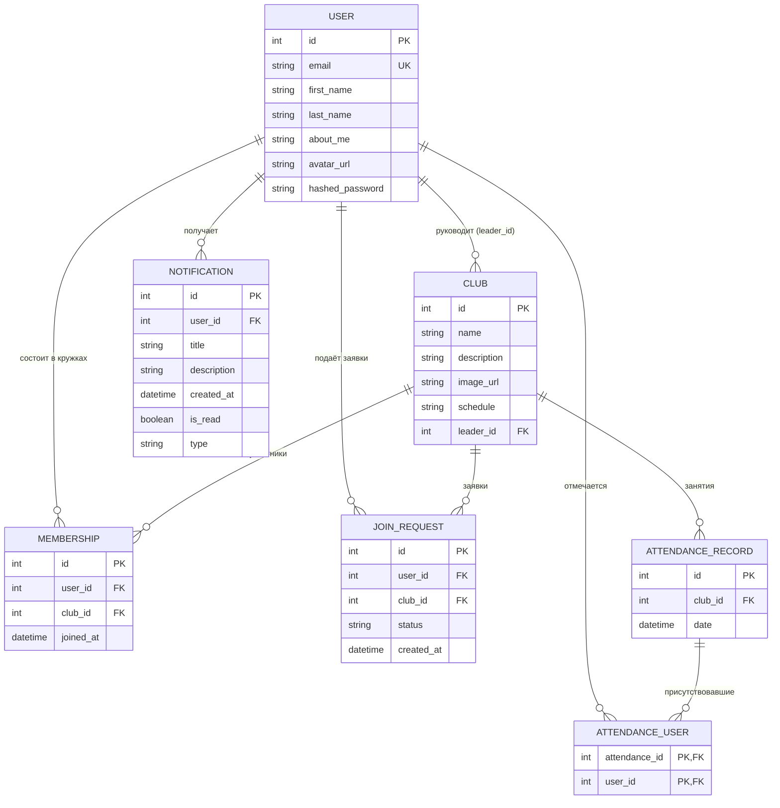
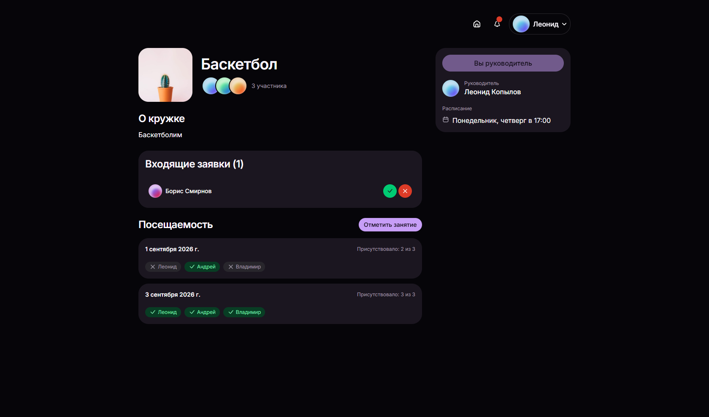

# Управление студенческими кружками

Веб-приложение для управления студенческими кружками: карточки кружков, набор участников, расписание и отметки посещаемости.

## Назначение приложения

Приложение помогает студентам находить кружки и вступать в них, а руководителям кружков принимать заявки, вести расписание и отмечать, кто присутствовал на занятиях.

Роли:

- **Участник** — просматривает кружки, подаёт заявки, видит расписание и профили других участников.
- **Руководитель** — пользователь, создавший кружок. Рассматривает заявки и отмечает посещаемость.

## Основные пользовательские сценарии

1. **Регистрация и вход** — пользователь создаёт аккаунт и авторизуется в системе.
2. **Просмотр доступных кружков** — на главной странице видны кружки, в которых пользователь уже состоит, и отдельно те, куда можно подать заявку.
3. **Подача заявки на вступление** — пользователь отправляет заявку в интересующий кружок и ожидает решения руководителя.
4. **Рассмотрение заявок** — руководитель просматривает список заявок и принимает или отклоняет их.
5. **Создание кружка** — пользователь заполняет название, описание, расписание и становится руководителем нового кружка.
6. **Просмотр карточки кружка** — фото, описание, руководитель, расписание, количество участников, список участников.
7. **Отметка посещаемости** — руководитель отмечает, что занятие состоялось, и выбирает присутствовавших участников; результаты отображаются на странице кружка.
8. **Управление профилем** — пользователь редактирует имя, фото и информацию о себе в настройках.
9. **Просмотр чужого профиля** — можно открыть профиль другого участника и увидеть, в каких кружках он состоит.
10. **Уведомления** — пользователь видит уведомления о статусе заявок и другую системную информацию.

## Экраны и маршруты

| Экран | Маршрут | Описание |
|---|---|---|
| Вход | `/login` | Форма входа (email, пароль) |
| Регистрация | `/signup` | Форма регистрации с подтверждением пароля |
| Главная | `/` | «Мои кружки» и «Другие кружки», кнопка создания кружка |
| Карточка кружка | `/club/:id` | Информация о кружке, участники, заявки и посещаемость (для руководителя) |
| Профиль | `/profile/:id` | Данные пользователя и его кружки |
| Настройки | `/settings` | Редактирование своего профиля |
| Не найдено | любой другой адрес | Страница 404 с кнопкой возврата на главную |

Дополнительные элементы интерфейса:

- модальное окно создания кружка;
- модальное окно отметки посещаемости;
- модальное окно со списком участников кружка;
- выпадающий список уведомлений и меню профиля в шапке.

Переходы между экранами реализованы клиентской маршрутизацией (`react-router-dom`).

## Технологии

### Frontend
- [React 19](https://react.dev/) + [TypeScript](https://www.typescriptlang.org/)
- [Vite](https://vite.dev/) — сборка и dev-сервер
- [React Router](https://reactrouter.com/) — клиентская маршрутизация
- [HeroUI v3](https://heroui.com/) — библиотека UI-компонентов
- [Tailwind CSS 4](https://tailwindcss.com/) — утилитарные стили
- [Gravity UI Icons](https://github.com/gravity-ui/icons) — иконки
- ESLint + typescript-eslint — проверка кода

### Backend
- [Python 3.11+](https://www.python.org/)
- [FastAPI](https://fastapi.tiangolo.com/) — веб-фреймворк для создания REST API
- [SQLModel](https://sqlmodel.tiangolo.com/) / [SQLAlchemy 2.0](https://www.sqlalchemy.org/) — ORM и декларативные модели данных
- [PostgreSQL](https://www.postgresql.org/) + [psycopg 3](https://www.psycopg.org/) — реляционная база данных и драйвер
- [Pydantic v2](https://docs.pydantic.dev/) — валидация и сериализация схем запросов/ответов
- [PyJWT](https://pyjwt.readthedocs.io/) + [bcrypt](https://pypi.org/project/bcrypt/) — авторизация по токенам JWT и безопасное хеширование паролей
- [Uvicorn](https://www.uvicorn.org/) — ASGI-сервер
- [Docker](https://www.docker.com/) & [Docker Compose](https://docs.docker.com/compose/) — контейнеризация всех сервисов

## Модель данных (БД)

Реляционная схема построена на **PostgreSQL** через **SQLModel** (надстройка над **SQLAlchemy 2.0**). Все связи поддержаны первичными и внешними ключами с каскадным удалением зависимых записей (`ON DELETE CASCADE`).



### Описание сущностей

1. **`User`** (`user`) — пользователи системы (студенты и руководители). Хранит email, имя, фамилию, аватар, текст «О себе» и хеш пароля (`bcrypt`).
2. **`Club`** (`club`) — студенческие кружки. Содержит название, описание, ссылку на обложку, расписание и идентификатор руководителя (`leader_id` -> `user.id`).
3. **`Membership`** (`membership`) — связь участников и кружков (`user_id` -> `user.id`, `club_id` -> `club.id`).
4. **`JoinRequest`** (`joinrequest`) — заявка на вступление студента в кружок со статусом (`pending`, `approved`, `rejected`). При одобрении руководителем автоматически создаётся запись в `membership` и уведомление студенту.
5. **`AttendanceRecord`** (`attendancerecord`) — занятие кружка с датой проведения (`club_id` -> `club.id`, `date`).
6. **`AttendanceUser`** (`attendanceuser`) — промежуточная таблица посещаемости (`attendance_id`, `user_id`), связывающая занятие со списком присутствовавших студентов.
7. **`Notification`** (`notification`) — уведомления для пользователя (одобрение/отклонение заявок, новые заявки для руководителя).

---

## Структура проекта

```text
student-club-project/
├── docker-compose.yml          # Запуск полного стека (postgres, backend, frontend)
├── .env.example                # Шаблон переменных окружения
├── .flake8                     # Конфигурация линтера Flake8
├── backend/                    # Backend (FastAPI + SQLModel + PostgreSQL)
│   ├── Dockerfile
│   ├── requirements.txt
│   ├── main.py                 # Экспорт точки входа FastAPI для uvicorn
│   ├── seed.py                 # Скрипт наполнения тестовыми данными
│   └── api/
│       ├── main.py             # Инициализация FastAPI, CORS, роутеры
│       ├── dependencies.py     # Сессии БД, JWT CurrentUserDep, права ClubLeaderAccessDep
│       ├── utils.py            # Хеширование bcrypt, чтение секретов
│       ├── db/
│       │   ├── db.py           # Подключение к PostgreSQL и создание таблиц
│       │   ├── models/         # Модели SQLModel (User, Club, Membership, ...)
│       │   └── utils/          # CRUD-функции и бизнес-логика работы с БД
│       ├── schemas/            # Pydantic-схемы валидации и сериализации (camelCase)
│       └── routers/            # Эндпоинты (auth, users, clubs, memberships, ...)
├── frontend/                   # Frontend (React 19 + HeroUI + Vite)
│   ├── Dockerfile
│   └── src/
│       ├── main.tsx            # Точка входа приложения
│       ├── app/                # Инициализация, маршрутизация, стили и тема
│       ├── pages/              # Композиционные страницы приложения
│       ├── features/           # Пользовательские действия (интерактивные сценарии)
│       ├── entities/           # Бизнес-сущности предметной области
│       └── shared/             # Общие переиспользуемые компоненты, утилиты и типы
└── docs/
    └── screenshots/            # Скриншоты интерфейса
```

### Архитектура Frontend (Feature-Sliced Design)

Клиентская часть организована по принципам упрощённой методологии **Feature-Sliced Design (FSD)**:

1. **`app/`** — конфигурация и точка сборки приложения:
   - `App.tsx` — маршрутизация (`react-router-dom`) и корневая конфигурация экранов;
   - `globals.css` — глобальные стили Tailwind CSS и дизайн-токены HeroUI;
   - `theme.ts` — инициализация и переключение цветовой темы.
2. **`pages/`** — страницы приложения, собирающие интерфейс из готовых сущностей и фичей:
   - `home/` — главная страница со списками кружков пользователя и каталогом;
   - `club/` — детальная страница кружка (информация, участники, посещаемость, модерация заявок);
   - `profile/` — профиль пользователя и его кружки;
   - `settings/` — настройки профиля текущего пользователя;
   - `login/` и `signup/` — страницы входа и регистрации;
   - `not-found/` — страница ошибки 404.
3. **`features/`** — пользовательские действия и интерактивные сценарии:
   - `auth/` — формы входа (`LoginForm`) и регистрации (`SignUpForm`);
   - `create-club/` — модальное окно и кнопка создания нового кружка (`NewClubButton`);
   - `manage-attendance/` — модальное окно фиксации посещаемости занятия (`AttendanceModal`);
   - `edit-profile/` — форма редактирования профиля и загрузки аватара (`EditProfileForm`).
4. **`entities/`** — предметные сущности со своими моделями данных, карточками и хелперами:
   - `club/` — карточки кружка (`ClubCard`), сетка (`ClubCardGrid`), моковые данные и селекторы;
   - `user/` — стек аватаров (`AvatarGroup`), модалка участников (`MembersModal`), кнопка профиля (`ProfileButton`), селекторы;
   - `attendance/` — модель и записи посещаемости;
   - `notification/` — модель уведомлений и выпадающий список (`NotificationButton`);
   - `join-request/` — модель заявок на вступление в кружки.
5. **`shared/`** — переиспользуемые строительные блоки без привязки к конкретной бизнес-логике:
   - `ui/` — универсальные компоненты интерфейса (`PasswordField`, `HeaderBar`, `EmptyState`, `LoadingState`);
   - `lib/` — вспомогательные утилиты и форматтеры (склонения чисел, форматирование ФИО, инициалы);
   - `types/` — общие TypeScript-интерфейсы моделей данных.

---

## Интеграция Frontend и Backend (Лабораторная работа №5)

В рамках лабораторной работы выполнена полная интеграция клиентской части (React 19 + HeroUI) и серверной части (FastAPI + SQLModel + PostgreSQL). Все моковые данные полностью заменены реальными сущностями из базы данных.

### 1. Архитектура клиентского взаимодействия с API (`frontend/src/shared/lib/api.ts`)
- **Базовый клиент (`apiFetch`)**:
  - Единая точка отправки HTTP-запросов к FastAPI-бэкенду (`/api/v1`).
  - Автоматическое добавление JWT Bearer-токена из `localStorage` в заголовки запросов `Authorization: Bearer <token>`.
  - Интеллектуальная работа с `FormData`: при загрузке файлов (обложек кружков, аватаров) заголовок `Content-Type: application/json` не устанавливается, позволяя браузеру корректно выставить `multipart/form-data` со сгенерированным boundary.
  - Локализация ошибок HTTP-статусов (401, 403, 404, 409, 422, 500) с выводом понятных сообщений на русском языке.
- **Типизированные сервисы API**:
  - `auth`: вход (`loginApi`), регистрация (`registerApi`), выход (`logoutApi`), обновление пары токенов (`refreshTokensApi`).
  - `clubs`: получение каталога (`getClubsApi`), просмотр кружка (`getClubByIdApi`), создание (`createClubApi`), редактирование (`updateClubApi`), удаление (`deleteClubApi`), загрузка изображения (`uploadClubImageApi`).
  - `memberships`: список участников кружка (`getClubMembersApi`), удаление участника руководителем (`removeMemberApi`), выход участника из кружка (`leaveClubApi`).
  - `join_requests`: получение заявок кружка (`getClubJoinRequestsApi`), отправка заявки (`createJoinRequestApi`), рассмотрение заявки (одобрение/отклонение `updateJoinRequestStatusApi`), отзыв заявки студентом (`deleteJoinRequestApi`).
  - `attendance`: история посещаемости (`getClubAttendanceApi`), создание занятия и отметка присутствующих (`createAttendanceRecordApi`).
  - `users`: данные текущего пользователя (`getCurrentUserApi`), просмотр профиля (`getUserByIdApi`), обновление профиля (`updateProfileApi`), загрузка аватара (`uploadAvatarApi`).
  - `notifications`: список уведомлений (`getNotificationsApi`), отметка о прочтении (`markNotificationReadApi`).

### 2. Централизованное состояние и CRUD-операции (`StoreContext` / `StoreProvider`)
- Все списки и сущности инициализируются запросами к реальной базе данных при старте приложения (`loadInitialData`).
- Реализованы сценарии:
  - **Кружки**: создание кружка с обложкой, редактирование информации, удаление кружка руководителем с подтверждением в модальном окне и перенаправлением на главную страницу.
  - **Заявки и участники**: отправка заявки студентом, отмена поданной заявки, одобрение руководителем (с автоматическим переводом в участники) и отклонение, добровольный выход из кружка.
  - **Посещаемость**: руководитель выбирает дату и отмечает участников из реального списка членов кружка; запись сохраняется в БД и сразу отображается в истории посещений.
  - **Профиль**: изменение имени, фамилии, описания «О себе» и загрузка персонального аватара.
  - **Уведомления**: реальные системные уведомления об одобрении заявок и новых запросах на вступление с возможностью отметить прочитанными.

### 3. Обработка состояний интерфейса (UX)
- **Состояния загрузки (`LoadingState`)**: централизованный индикатор `isLoading` отображает спиннер и понятное сообщение на главной странице, карточке кружка и профиле до завершения первичных запросов к API.
- **Пустые состояния (`EmptyState`)**: информативные блоки со специальными иконками отображаются, если у пользователя нет кружков, в каталоге пусто, нет поданных заявок, отсутствуют участники или нет записей о занятиях.
- **Обработка ошибок и валидация**:
  - Ошибки авторизации (401) и отказа в доступе (403) выводятся в понятном виде.
  - Ошибки валидации (422) и конфликты уникальности данных (409) отображаются непосредственно пользователю.
  - Разграничение прав на клиенте: кнопки модерации заявок, отметки посещаемости и удаления кружка видны и доступны только руководителю кружка (`leaderId === currentUser.id`).

---

## Запуск проекта

### Вариант 1. Запуск через Docker Compose (Рекомендуемый)

Для полного запуска базы данных PostgreSQL, бэкенда и фронтенда потребуется только [Docker Desktop](https://www.docker.com/products/docker-desktop/).

1. Скопируйте файл с переменными окружения:
   ```bash
   cp .env.example .env
   ```

2. Запустите все сервисы:
   ```bash
   docker compose up --build
   ```

3. Сервисы будут доступны по адресам:
   - **Frontend:** <http://localhost:3000>
   - **Backend API:** <http://localhost:8000>
   - **Интерактивная документация Swagger UI:** <http://localhost:8000/docs>
   - **Документация ReDoc:** <http://localhost:8000/redoc>
   - **База данных PostgreSQL:** `localhost:5432`

---

### Вариант 2. Локальный запуск Backend

1. **Требования:** Python 3.11+ и запущенный сервер PostgreSQL.
2. **Установка зависимостей:**
   ```bash
   cd backend
   pip install -r requirements.txt
   ```
3. **Настройка переменных окружения:**
   Создайте файл `backend/.env` на основе шаблона `backend/.env.example`:
   ```env
   POSTGRES_USER=postgres
   POSTGRES_PASSWORD=postgrespassword
   POSTGRES_DB=student_clubs
   POSTGRES_HOST=localhost
   POSTGRES_PORT=5432
   SECRET_KEY=your_secret_key_here
   DEBUG=False
   CORS_ORIGINS=*
   ```
4. **Создание таблиц:**
   Таблицы в базе данных создаются **автоматически** при старте приложения функцией `create_db_and_tables()` в `api/db/db.py`.
5. **Запуск сервера разработки:**
   ```bash
   uvicorn main:app --reload --host 0.0.0.0 --port 8000
   ```
6. **(Опционально) Наполнение тестовыми данными:**
   Для быстрого заполнения базы тестовыми кружками, пользователями, заявками и посещаемостью запустите сидер:
   ```bash
   python seed.py
   ```

---

### Вариант 3. Локальный запуск Frontend

1. **Требования:** Node.js 20.19+ (или 22.12+) и npm.
2. **Установка и запуск:**
   ```bash
   cd frontend
   npm install
   npm run dev
   ```
   Приложение откроется по адресу <http://localhost:5173>.

---

## Проверка качества кода

- **Линтинг бэкенда (Flake8):**
  ```bash
  python -m flake8 backend
  ```
- **Проверка статической типизации (MyPy):**
  ```bash
  python -m mypy backend
  ```
- **Линтинг фронтенда (ESLint):**
  ```bash
  cd frontend
  npm run lint
  ```

---

## Скриншоты

Скриншоты реализованных экранов лежат в [`frontend/docs/screenshots`](frontend/docs/screenshots).

| Экран | Десктоп | Мобильная версия |
|---|---|---|
| Главная | `frontend/docs/screenshots/desktop/Home.png` | `frontend/docs/screenshots/mobile/Home.png` |
| Карточка кружка | `frontend/docs/screenshots/desktop/Club.png` | `frontend/docs/screenshots/mobile/Club.png` |
| Создание кружка | `frontend/docs/screenshots/desktop/CreateClubPage.png` | — |
| Вход | `frontend/docs/screenshots/desktop/LogIn.png` | `frontend/docs/screenshots/mobile/LogIn.png` |
| Регистрация | `frontend/docs/screenshots/desktop/SignUp.png` | `frontend/docs/screenshots/mobile/SignUp.png` |
| Мой профиль | `frontend/docs/screenshots/desktop/MyProfile.png` | `frontend/docs/screenshots/mobile/MyProfile.png` |
| Чужой профиль | `frontend/docs/screenshots/desktop/OtherProfile.png` | `frontend/docs/screenshots/mobile/OtherProfile.png` |
| Настройки | `frontend/docs/screenshots/desktop/Settings.png` | `frontend/docs/screenshots/mobile/Settings.png` |



