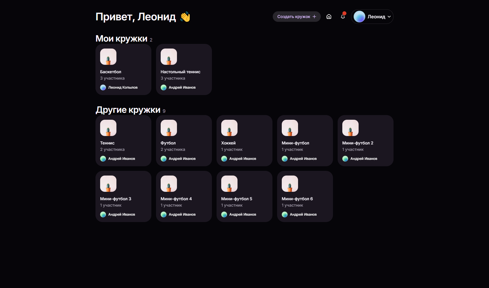

# Управление студенческими кружками

Веб-приложение для управления студенческими кружками: карточки кружков, набор участников, расписание и отметки посещаемости.

## Назначение приложения

Приложение помогает студентам находить кружки и вступать в них, а руководителям кружков принимать заявки, вести расписание и отмечать, кто присутствовал на занятиях.

Роли:

- **Участник** — просматривает кружки, подаёт заявки, видит расписание и профили других участников.
- **Руководитель** — пользователь, создавший кружок. Рассматривает заявки и отмечает посещаемость.

## Основные пользовательские сценарии

1. **Регистрация и вход** — пользователь создаёт аккаунт и авторизуется в системе.
2. **Просмотр доступных кружков** — на главной странице видны кружки, в которых пользователь уже состоит, и отдельно те, куда можно подать заявку.
3. **Подача заявки на вступление** — пользователь отправляет заявку в интересующий кружок и ожидает решения руководителя.
4. **Рассмотрение заявок** — руководитель просматривает список заявок и принимает или отклоняет их.
5. **Создание кружка** — пользователь заполняет название, описание, расписание и становится руководителем нового кружка.
6. **Просмотр карточки кружка** — фото, описание, руководитель, расписание, количество участников, список участников.
7. **Отметка посещаемости** — руководитель отмечает, что занятие состоялось, и выбирает присутствовавших участников; результаты отображаются на странице кружка.
8. **Управление профилем** — пользователь редактирует имя, фото и информацию о себе в настройках.
9. **Просмотр чужого профиля** — можно открыть профиль другого участника и увидеть, в каких кружках он состоит.
10. **Уведомления** — пользователь видит уведомления о статусе заявок и другую системную информацию.

## Экраны и маршруты

| Экран | Маршрут | Описание |
|---|---|---|
| Вход | `/login` | Форма входа (email, пароль) |
| Регистрация | `/signup` | Форма регистрации с подтверждением пароля |
| Главная | `/` | «Мои кружки» и «Другие кружки», кнопка создания кружка |
| Карточка кружка | `/club/:id` | Информация о кружке, участники, заявки и посещаемость (для руководителя) |
| Профиль | `/profile/:id` | Данные пользователя и его кружки |
| Настройки | `/settings` | Редактирование своего профиля |
| Не найдено | любой другой адрес | Страница 404 с кнопкой возврата на главную |

Дополнительные элементы интерфейса:

- модальное окно создания кружка;
- модальное окно отметки посещаемости;
- модальное окно со списком участников кружка;
- выпадающий список уведомлений и меню профиля в шапке.

Переходы между экранами реализованы клиентской маршрутизацией (`react-router-dom`).

## Технологии

- [React 19](https://react.dev/) + [TypeScript](https://www.typescriptlang.org/)
- [Vite](https://vite.dev/) — сборка и dev-сервер
- [React Router](https://reactrouter.com/) — клиентская маршрутизация
- [HeroUI v3](https://heroui.com/) — библиотека UI-компонентов
- [Tailwind CSS 4](https://tailwindcss.com/) — утилитарные стили
- [Gravity UI Icons](https://github.com/gravity-ui/icons) — иконки
- ESLint + typescript-eslint — проверка кода

### Выбор UI-библиотеки

Использована **HeroUI**: она построена на доступных (accessible) примитивах, содержит готовые формы, модальные окна, карточки, выпадающие списки и аватары, а единая система токенов (`--accent`, `--surface`, `--muted` и др.) в `src/globals.css` обеспечивает одинаковое оформление всех экранов. Через те же токены работает **тёмная тема**: она включается автоматически по системным настройкам.

Читаемость и адаптивность обеспечиваются так:

- сетка карточек перестраивается от одной колонки на телефоне до нескольких на широком экране;
- контент ограничен по ширине (`max-w-*`) и имеет боковые отступы на мобильных экранах;
- модальные окна ограничены по высоте, длинные списки прокручиваются внутри;
- цвета берутся только из токенов темы, поэтому контраст сохраняется в светлой и тёмной теме.

## Запуск

Требуется Node.js 20.19+ (или 22.12+) и npm.

```bash
npm install
npm run dev
```

После запуска приложение доступно по адресу, который выведет Vite (обычно <http://localhost:5173>).

### Как пройти по приложению

Бэкенда пока нет, поэтому авторизация имитируется: на экранах входа и регистрации любые корректно заполненные поля ведут на главную страницу. Текущий пользователь берётся из демонстрационных данных (`src/data/mockUsers.tsx`).

## Структура проекта

```text
src/
├── App.tsx             # маршрутизация
├── main.tsx            # точка входа, подключение стилей и темы
├── theme.tsx           # переключение темы по системным настройкам
├── globals.css         # токены темы HeroUI (светлая и тёмная)
├── types.tsx           # типы: User, Club, Membership, JoinRequest, ...
├── pages/              # страницы приложения
├── components/         # переиспользуемые компоненты (шапка, карточки, модальные окна)
└── data/               # демонстрационные данные и вспомогательные функции
docs/
└── screenshots/        # скриншоты экранов
```

Модель данных (`src/types.tsx`): пользователи, кружки, членство, заявки на вступление, уведомления и записи посещаемости. Связи между сущностями заданы по идентификаторам, как в будущей базе данных.

## Демонстрационные данные и ограничения

На этом этапе все данные хранятся в `src/data/*` и живут только в памяти браузера. Поэтому:

- изменения (заявки, отметки посещаемости, правки профиля) не сохраняются после перезагрузки страницы;
- состояние части экранов хранится локально внутри страницы и не передаётся между экранами;
- вход и регистрация только имитируются, проверки пользователя нет.

Эти ограничения будут сняты на следующих этапах: общее хранилище состояния, валидация форм, интеграция с API.

## Скриншоты

Скриншоты реализованных экранов лежат в [`docs/screenshots`](docs/screenshots).

| Экран | Файл |
|---|---|
| Вход | `docs/screenshots/login.png` |
| Регистрация | `docs/screenshots/signup.png` |
| Главная | `docs/screenshots/home.png` |
| Карточка кружка (участник) | `docs/screenshots/club-member.png` |
| Карточка кружка (руководитель) | `docs/screenshots/club-leader.png` |
| Создание кружка | `docs/screenshots/new-club-modal.png` |
| Отметка посещаемости | `docs/screenshots/attendance-modal.png` |
| Список участников | `docs/screenshots/members-modal.png` |
| Профиль | `docs/screenshots/profile.png` |
| Настройки | `docs/screenshots/settings.png` |
| Уведомления | `docs/screenshots/notifications.png` |
| Страница 404 | `docs/screenshots/not-found.png` |
| Главная на телефоне | `docs/screenshots/home-mobile.png` |
| Главная в тёмной теме | `docs/screenshots/home-dark.png` |




При последующих изменениях интерфейса скриншоты обновляются, а причины существенных изменений или упрощений фиксируются в разделе ниже.

### История изменений интерфейса

- _Пока без существенных изменений._
